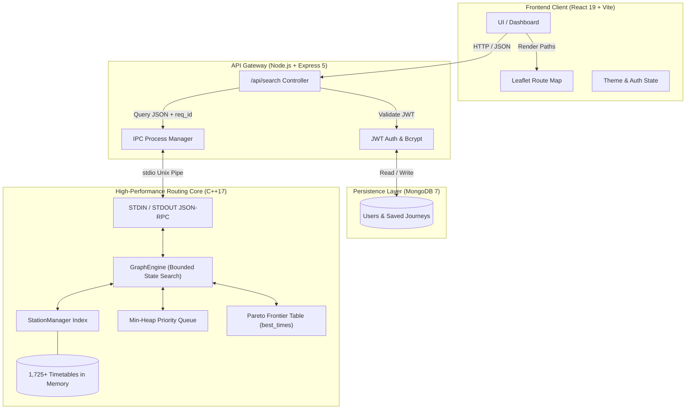

# RapidRails — Train Route Optimization System

<p align="center">
  
</p>

<p align="center">
  <strong>Sub-50ms multi-hop railway itinerary optimization over temporal schedules using Bounded State-Space Search and Relaxed Pareto Pruning.</strong>
</p>

<p align="center">
  <a href="#core-routing-algorithm--complexity-analysis"></a>
  <a href="#tech-stack"></a>
  <a href="#running-with-docker-compose-recommended"></a>
</p>

---

## Executive Summary

Traditional railway search systems struggle when querying multi-leg routes requiring platform transfers across complex national networks. Unlike road networks modeled as static spatial graphs, railway routing is **inherently dynamic and time-dependent**:

* **Temporal Edge Validity**: A connection between Station $A$ and Station $B$ does not exist statically; it is only traversable at discrete moments governed by operating calendars and timetable departures.
* **Realistic Transfer Layover Buffers**: Feasible transfers demand human-realistic layovers (`min_buffer` $\le \Delta t \le$ `max_buffer`) preventing missed connections or grueling multi-hour station waits.
* **State-Space Explosion**: Multi-leg permutations explode combinatorially ($\mathcal{O}(B^L)$) if naive breadth-first or depth-first searches are executed across thousands of interconnected trains.

**RapidRails** resolves this by decoupling compute-heavy graph processing from I/O operations:
1. **Core C++17 Routing Engine**: Executes a specialized **Bounded State-Space Search (Modified Time-Dependent Dijkstra)** utilizing **Top-K Relaxed Pareto Pruning** and origin-offset cycle prevention.
2. **Asynchronous Non-Blocking IPC**: A Node.js Express gateway manages client sessions, authentication, and communication with the persistent C++ engine via line-delimited JSON Unix pipes.
3. **Reactive Geo-Spatial Frontend**: Built with React 19, Tailwind CSS v4, and Leaflet, displaying multi-transfer paths, real-time stop metrics, and interactive route polylines.

---

## Application Preview

### Route Search Interface
<p align="center">
  
</p>

### Multi-Leg Results
<p align="center">
  
</p>

<p align="center">
  
</p>

---

## System Architecture



### Architectural Highlights

* **Zero Garbage Collection Overhead during Graph Search**: State-space traversal creates and destroys millions of priority queue entries. Moving this logic to C++ eliminates V8 garbage collection pauses, keeping search latency predictable.
* **Line-Delimited JSON IPC**: Instead of Node-API (N-API) bindings that induce context-switching overhead and thread-boundary synchronization costs, the Node gateway communicates with the compiled C++ binary through persistent `stdin`/`stdout` streams with UUID-tagged request/response envelopes.
* **In-Memory Pre-Indexed Graph**: At launch, 1,725+ train schedules spanning 8,400+ stations are loaded into an inverted station-to-train adjacency index (`StationManager::stationToTrains`), enabling $\mathcal{O}(1)$ train lookup per station expansion.

---

## Core Routing Algorithm & Complexity Analysis

### 1. Algorithm Design: Bounded State-Space Search

Standard Dijkstra calculates the shortest path on a static weight graph. In railway networks, transit graphs are **time-dependent**: trains operate only on specific days of the week, depart at specific times, and require valid transfer buffers between legs.

Each state in the priority queue tracks:
`State = { station, absolute_time, legs, path }`

* **Min-Heap Evaluation**: States are prioritized by the **earliest absolute arrival time** (`absolute_time`). If times tie, journeys with fewer transfers (`legs`) take precedence.
* **Cyclic Multi-Day Timetable Wrapping**: Train departures are evaluated against 7-day cyclical schedules using backward origin calculation. If the user departs at relative minute $T$ and the timetable departure is at minute $M$, the origin day offset $K$ is computed with a custom `floorDiv` helper:
  $$K = \left\lfloor \frac{T - M}{1440} \right\rfloor$$
  This prevents C++ integer division round-towards-zero bugs when evaluating negative minute offsets across midnight boundaries.
* **Cycle Prevention**: Each state checks its internal `path` history in $\mathcal{O}(L)$ to ensure the user does not revisit an already traversed station.

### 2. Pruning Strategy: Top-K Relaxed Pareto Front

Unconstrained state search leads to exponential branching. RapidRails applies a dual-layer pruning mechanism:

1. **Top-K Pareto Frontier ($K = 4$)**:
   The engine maintains `best_times[station][legs]`, storing up to $K = 4$ non-dominated arrival timestamps per station for each leg count. This permits slightly later trains to survive if they enable high-speed onward connections, without preserving uncompetitive branches.
2. **Aggressive Arrival Ceiling**:
   If a candidate route arrives more than 12 hours (720 minutes) later than an existing route that required fewer transfers, the candidate branch is killed immediately:
   $$\text{Arr}_{\text{candidate}} > \text{Arr}_{\text{fewer}} + 720\text{ min}$$

---

### 3. Time Complexity Formulation

Let the network variables be defined as:
* $S$: Total stations in the network ($\approx 8,480$)
* $L$: Maximum allowed transfer legs (`max_legs` $\le 8$, typically default 2 to 4)
* $K$: Relaxed Pareto factor ($K = 4$)
* $T_s$: Average number of trains serving a single station ($\approx 15\text{--}45$)

$$\boxed{\mathbf{Time\ Complexity} = \mathcal{O}\Big(S \cdot K \cdot L \cdot T_s \cdot \big(L + \log(S \cdot K \cdot L)\big)\Big)}$$

#### Mathematical Breakdown:
1. **Maximum State Expansions**: Due to the Pareto filter, each station can be extracted from the priority queue at most $K \cdot L$ times, bounding total popped states to $\mathcal{O}(S \cdot K \cdot L)$.
2. **Branching Factor per State**: For each popped state, the engine iterates over $T_s$ passing trains and explores $M$ downstream stops.
3. **Inner Loop Cost**:
   * Cycle validation against journey history: $\mathcal{O}(L)$
   * Pareto check across fewer-leg records: $\mathcal{O}(L)$
   * Priority queue insertion: $\mathcal{O}(\log(S \cdot K \cdot L))$

#### Space Complexity:
$$\mathbf{Space\ Complexity} = \mathcal{O}(S \cdot K \cdot L)$$
Bounded by the Pareto tracking table `best_times` and heap elements allocated during exploration.

---

### 4. Empirical Benchmarks

| Metric | Measured Value | Notes |
|---|---|---|
| **Dataset Size** | 1,725 Train Timetables | Full Indian Railways schedule corpus |
| **Indexed Stations** | 8,480 Stations | Pre-loaded in `StationManager` hash table |
| **Typical Query Latency** | **5 ms — 50 ms** | 1 to 4 transfer legs on commodity CPU |
| **IPC Round-Trip Overhead** | **< 2 ms** | `stdin`/`stdout` JSON serialization via `nlohmann::json` |
| **Engine Startup Time** | **~250 ms** | Single-pass directory read & adjacency construction |

---

## Tech Stack

### Core Routing Engine (C++)
* **Language**: C++17 (`-std=c++17 -O2`)
* **Data Structures**: Min-Heap (`std::priority_queue`), Hash Indices (`std::unordered_map`), Deque storage (`std::deque`)
* **Serialization**: `nlohmann/json` (Header-only modern JSON parsing)
* **Build System**: GNU Make

### Backend Gateway (Node.js)
* **Runtime**: Node.js (ES Modules)
* **Framework**: Express 5
* **Database ODM**: Mongoose 9 / MongoDB 7
* **Security & Auth**: JSON Web Tokens (`jsonwebtoken`), `bcryptjs`
* **Mailer**: Nodemailer (SMTP password reset verification)

### Frontend Application (React)
* **Framework**: React 19 + Vite 7
* **Styling**: Tailwind CSS v4 + Custom Responsive Themes (Light / Dark)
* **Geo-Mapping**: Leaflet + React-Leaflet
* **Icons & Notifications**: Lucide React + React-Toastify
* **Routing**: React Router 7

### DevOps & Containerization
* **Container Orchestration**: Docker Compose
* **Frontend Server**: Nginx (Alpine-based reverse proxy)
* **Database**: MongoDB 7 Official Image

---

## Concise REST API Reference

### 1. Route Optimization
```http
POST /api/search
```
**Request Body:**
```json
{
  "source": "NDLS",
  "destination": "BCT",
  "day": 1,
  "min_buffer": 30,
  "max_buffer": 480,
  "max_legs": 3,
  "preference": "convenient"
}
```
**Response (200 OK):**
```json
[
  {
    "hash": "12002|NDLS|BCT|",
    "total_duration": 945,
    "legs": [
      {
        "train_num": "12002",
        "train_name": "SHATABDI EXP",
        "train_type": "EXP",
        "from": "NDLS",
        "to": "BCT",
        "dep_clock": "06:00",
        "arr_clock": "21:45",
        "dep_day": 1,
        "arr_day": 1,
        "classes_available": ["1A", "2A", "3A"]
      }
    ]
  }
]
```

### 2. User Authentication
| Endpoint | Method | Payload | Description |
|---|---|---|---|
| `/api/register` | `POST` | `{ "email", "password" }` | Create user account |
| `/api/login` | `POST` | `{ "email", "password" }` | Returns JWT auth token |
| `/api/forgot-password`| `POST` | `{ "email" }` | Sends 6-digit verification code |
| `/api/verify-reset-code`| `POST`| `{ "email", "code", "newPassword" }` | Updates account password |

### 3. Bookmarks & System Health
| Endpoint | Method | Auth | Description |
|---|---|---|---|
| `/api/favorites` | `GET` | Yes | Retrieves user's saved itineraries |
| `/api/fav-add` | `POST` | Yes | Saves journey object by hash |
| `/api/fav-delete/:hash` | `DELETE`| Yes | Removes saved journey |
| `/api/health` | `GET` | No | Returns engine status & MongoDB connectivity |

---

## Getting Started

### Option 1: Running with Docker Compose (Recommended)

1. **Clone the repository:**
   ```bash
   git clone https://github.com/your-username/RapidRails.git
   cd RapidRails
   ```

2. **Configure environment variables:**
   ```bash
   cp .env.example .env
   ```

3. **Build and start all services:**
   ```bash
   docker compose up --build
   ```

4. **Access the application:**
   * **Web Client**: [http://localhost:3000](http://localhost:3000)
   * **API Gateway**: [http://localhost:10000](http://localhost:10000)
   * **Health Check**: [http://localhost:10000/api/health](http://localhost:10000/api/health)

> [!NOTE]
> **Pre-Seeded Demo Account**:  
> Email: `omkar@gmail.com`  
> Password: `Qwert@123`

To stop services:
```bash
docker compose down
```

---

### Option 2: Manual Local Setup (Without Docker)

#### 1. Compile C++ Routing Engine & Launch Backend
```bash
cd train-backend

# Compile C++17 engine binary to train-backend/train_engine
npm run build

# Install dependencies and start Express server
npm install
npm start
```
*The backend server will automatically spawn `./train_engine ./train_data` and verify ready status.*

#### 2. Start React Frontend
In a new terminal window:
```bash
cd train-frontend

# Install dependencies
npm install

# Start Vite development server
npm run dev
```
Open [http://localhost:5173](http://localhost:5173) in your browser.

