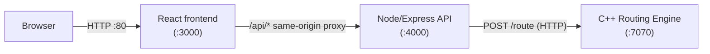

# Railway Journey Routing

A full-stack train journey planner that finds the **50 earliest-arriving valid journeys between any two of 2,894 Indian railway stations**, with any number of transfers, and serves them at interactive latency.

The project consists of three core components:
- **Routing Engine (C++)**: A high-performance custom routing core running an exact A*-style K-best path search over a relaxed backward profile scan.
- **API Tier (Node/Express)**: Validates input, dispatches queries to the engine, hydrates and renders compact journeys into complete itineraries with intermediate stops, and provides station search.
- **Frontend (React)**: An interactive web application built with React, Vite, and Tailwind CSS, featuring station selection, route filtering, journey comparisons, and map visualization.

Performance benchmarks, distributed scaling studies on AWS (scaling to ~1,100 requests/second under a strict latency SLO), and architectural evaluations are documented in [results/distributed-benchmarks.md](results/distributed-benchmarks.md) and [results/load-test-report.md](results/load-test-report.md).

## Quick start

### Docker (full stack)

```bash
docker compose up -d --build
open http://localhost:${PUBLIC_PORT:-80}
```

Service port exposure:
- **Frontend**: Published on `http://localhost:${PUBLIC_PORT:-80}` (defaults to port 80).
- **API**: Published on `http://localhost:${API_PORT:-4000}` (defaults to port 4000).
- **Routing Engine**: Runs internally on port 7070 on the Docker private backend network.

### Local development

Requirements: Node ≥ 22.18, g++ ≥ 13 or clang ≥ 17, CMake ≥ 3.20. C++ dependencies are vendored, so builds work offline.

```bash
cd scripts && node preprocess.ts    # raw train JSON -> routing timetable (data/processed/)
cmake -S routing-engine -B routing-engine/build -DCMAKE_BUILD_TYPE=Release
cmake --build routing-engine/build -j
TIMETABLE_PATH=data/processed/timetable.json routing-engine/build/routing_engine   # engine on :7070
cd api && npm ci && ENGINE_URL=http://127.0.0.1:7070 npm start                    # API on :4000
cd frontend && npm ci && npm run build && API_INTERNAL_URL=http://127.0.0.1:4000 npm start   # React SPA on :3000
```

## Architecture

The standard single-host deployment comprises the React frontend, Node/Express API gateway, and the C++ routing engine.



### Components

1. **Frontend (React + Vite)**: Provides station pickers, filter controls (max duration, max transfers, direct trains), journey detail cards, and an interactive map. Includes a same-origin reverse proxy that relays requests to the API.
2. **API Tier (Node/Express)**: Loads station metadata and timetable definitions directly from static JSON files (`stations.json`, `timetable.json`). Validates query inputs with Zod, resolves station codes, queries the C++ engine over HTTP, and formats the compact journey representation into full itineraries with intermediate stop timelines and distance calculations.
3. **C++ Routing Engine**: Loads the preprocessed timetable into memory (~100 MB), precomputes weekday patterns, and executes the backward profile scan and best-first A* search. Returns compact journey signatures (~9 KB) to minimize serialization overhead.

## How the routing works

The timetable comes from 1,725 raw train records (30,796 stops). Times are converted to absolute minutes using the dataset's `day_of_journey` rule — the day refers to the **departure** from each stop — which makes every train's stop sequence monotone. A query on date Q considers train instances that started on Q−3 … Q+4 (trains already en route and journeys spanning several days), requires a 30-minute minimum transfer, and forbids touching any station twice.

Per query, the engine:

1. **Precomputes per-weekday patterns at startup** — instances and connections for each weekday, sorted once, so query setup takes ~0.2 ms.
2. **Runs a backward connection scan** from the destination (one pass, O(C) over ~130k connections), giving an exact earliest-arrival lower bound for every (train, stop) — a relaxation of the real rules, so it never overestimates.
3. **Enumerates journeys best-first (A\*)**. Partial journeys are popped from a heap in exact rank order (arrival, −first departure, transfers, waiting) and expanded by riding on, alighting, or transferring. Because the bound is admissible and consistent, the first completed journey popped is provably the next best one.
4. **Applies exact dominance rules** that drop journeys with pointless train changes (e.g. get off a train that already reaches your destination) — only when a strictly better valid journey is guaranteed.
5. **Stops at K accepted journeys** or a deterministic label budget (`MAX_LABELS`). The budget can only truncate the list, never misorder it; the response carries `search_complete: false` when hit (~2.4 % of random queries at K = 50).

Dijkstra, CSA and RAPTOR compute one earliest arrival or a Pareto set — not a ranked top-K of distinct journeys. Yen's K-shortest-paths on a time-expanded graph (~60k event nodes/day, K full shortest-path rounds) is too slow for interactive use and maps poorly to the no-repeated-station rule.

## Complexity

C ≈ 130k connections in the query horizon, L = labels created, d = departures per station:

| Stage | Cost |
|---|---|
| Startup (once per weekday pattern) | O(C log C) — ~100–360 ms total load |
| Backward profile (per query) | O(C) |
| Search (per query) | O(L log L), O(log d) per boarding lookup; ~3.5k labels at the median, 22k at p90 |
| Memory | ~100 MB resident timetable + patterns; O(C + L) per query, thread-local arenas |

## API

`POST /api/routes` with `source`, `destination`, `date`, `time`, optional `limit`/`page`/`filters`:

```json
{ "source": "BD", "destination": "NDLS", "date": "2026-09-25", "time": "10:00", "limit": 5, "page": 1 }
```

The engine computes the full top-50 once; the API hydrates this compact result, applies filtering and pagination, and renders segments with intermediate stops, transfers, durations, and distances. `meta` reports `engine_ms`, `api_ms`, `search_complete`, and the worker ID.

`GET /api/stations?q=` provides tiered prefix and substring search over station codes and names (exact code → code prefix → name prefix → substring).

`GET /api/stations/:code` returns station details and known aliases.

`GET /health` reports service and engine status.

Errors: `400` for validation issues or unknown station codes, `404` for missing routes or stations, `503` when the engine is unavailable.

## Benchmarks & Scalability Studies

Detailed load-testing reports and scalability evaluations are maintained in the `results/` folder:

- **[Distributed Benchmarks & Caching](results/distributed-benchmarks.md)**: Engine micro-benchmarks, end-to-end Autocannon throughput runs, compact serialization benefits, and multi-worker architecture.
- **[AWS Load-Testing & USL Study](results/load-test-report.md)**: Controlled capacity study across 10 AWS instances with k6, Universal Scalability Law modeling, API vs. engine bottleneck identification, and fault-injection evaluations.
