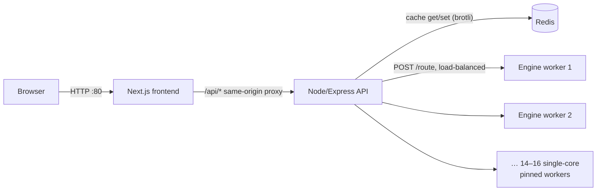

# Distributed Architecture & Benchmark Experiments

This document records the distributed multi-worker setup, end-to-end load benchmarks, and caching experiments evaluated during the project's capacity studies on AWS and local multicore environments.

For the in-depth 10-instance AWS capacity study with USL modeling and failure injection, see [load-test-report.md](load-test-report.md).

---

## 1. Distributed AWS Architecture

In the scaled AWS study setup, the stateless C++ routing engine ran as **one single-core worker per vCPU**, cpuset-pinned on dedicated worker hosts. The Node/Express API acted as the gateway and dispatched searches across the worker fleet.

### Key Distributed Subsystems

- **Worker Pool & Load Balancing**: The API gateway maintained a pool of single-core engine workers, dispatching queries using least-inflight load balancing.
- **Concurrency & Admission Queue**: Each worker enforced single-query concurrency limits. When all worker queues were saturated, the gateway answered with `429 OVERLOADED` (carrying `retry-after: 1`) to preserve p99 latency for inflight requests.
- **Hedging & Retries**: Requests experiencing tail latency or network stalls were re-dispatched to an alternate worker after a deadline. Dead workers were ejected after 3 failed consecutive health checks.
- **Redis Cache (Brotli Compression)**: Search results were stored in a shared Redis cache with brotli compression. Because the engine always computes the top-K journeys once, subsequent filtering, sorting, or pagination requests were served directly from the cache.
- **Fail-Open Design**: If Redis crashed or became unreachable, the system failed open—all queries bypassed the cache and were computed directly by the engine workers without client-visible errors.

---

## 2. Engine Micro-Benchmarks

Single-thread routing performance was measured on an x86-64 test environment across 1,000 uniformly random queries ($K = 50$, `MAX_LABELS = 500,000`):

| Metric | Measured Value |
| :--- | :--- |
| **Timetable load + pattern build** | 100–360 ms |
| **p50 Latency** | 7.5 ms |
| **p90 Latency** | 28.3 ms |
| **p95 Latency** | 59.6 ms |
| **p99 Latency** | 201 ms |
| **Max Latency** | 267 ms |
| **Budget hits (`search_complete: false`)** | 2.4 % of queries |

---

## 3. End-to-End Latency & Throughput (Autocannon)

End-to-end performance measured through the Next.js proxy (20-second runs, $K = 20$):

| Scenario | Throughput | Client p50 / p99 | Engine p50 / p99 |
| :--- | :--- | :--- | :--- |
| **API direct, cold (1 connection)** | ~33 req/s | 26 ms / 105 ms | 8.0 ms / 90 ms |
| **API direct, cached (10 connections)** | ~300 req/s | 27 ms / 92 ms | Cache hits |
| **Public path, cold (10 connections)** | ~68 req/s | 138 ms / 289 ms | 13.0 ms / 110 ms |
| **Public path, cached (10 connections)** | ~113 req/s | 83 ms / 143 ms | Cache hits |

---

## 4. Compact Serialization Impact

In the initial design, the C++ engine serialized full journey responses containing all intermediate station names, timestamps, and coordinates (~260 KB per response). 

Refactoring the engine to return compact leg indices (`[train_id, board_stop, alight_stop, start_day]`, ~9 KB per response) and delegating full response rendering to the Node API produced substantial gains:

- **Local 4-worker stack breakpoint**: Shifted from ~58 req/s to ~108 req/s within the 500 ms p99 SLO.
- **Median API overhead**: Decreased from 35–40 ms down to ~19 ms.
